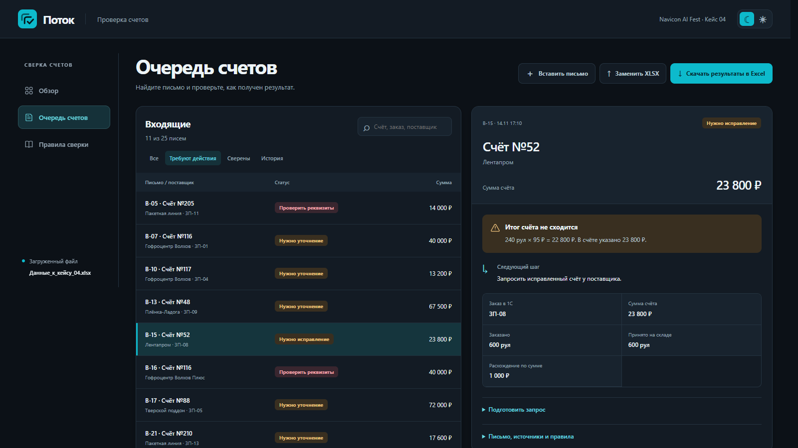

<p align="center">
  
</p>

<h1 align="center">Поток</h1>

<p align="center">Программа для проверки счетов поставщиков</p>

<p align="center">
  <a href="https://github.com/whiterli/potok-downloads/releases/download/v1.7.0/Potok-1.7.0.exe"><strong>Скачать «Поток» 1.7.0 для Windows без входа</strong></a>
  &nbsp;·&nbsp;
  <a href="https://navicons.com/careers/ai-fest-2026/cases/#case-04">Скачать учебную таблицу</a>
  &nbsp;·&nbsp;
  <a href="./Potok-Navicon-AI-Fest.pptx">Презентация</a>
</p>

«Поток» сравнивает счета с заказами, данными о полученных товарах и согласованными условиями. Если цена, количество или сумма расходятся, программа показывает, где возникла разница и у кого её уточнить. Загруженные данные обрабатываются на вашем компьютере.

## Что нового в версии 1.7.0

Новый обзор с диаграммой результатов, боковая навигация и более понятная карточка счёта. Доступны тёмная и светлая темы в цветах Navicon, плавная заставка и переключение тем.

## Как начать

1. **Скачайте программу.** Нажмите ссылку выше и откройте файл `Potok-1.7.0.exe` из папки «Загрузки». Установщик не нужен. Программа рассчитана на Windows x64. Ссылка на скачивание открывается без аккаунта GitHub.
2. **Скачайте таблицу для примера.** На [странице кейса №04](https://navicons.com/careers/ai-fest-2026/cases/#case-04) найдите раздел «Что вам дают» и нажмите **XLSX ↓**. Сохраните файл `Данные_к_кейсу_04.xlsx`.
3. **Загрузите таблицу.** В окне «Потока» нажмите **«Выбрать файл XLSX»** и откройте скачанную таблицу. Откроется обзор сверки. На учебной таблице он покажет, что 11 из 25 писем требуют внимания.
4. **Откройте результат.** На обзоре нажмите **«Открыть спорные письма»** или выберите письмо в блоке **«С чего начать»**. В очереди нажмите на нужную строку. Справа откроется карточка с объяснением и следующим шагом. Правила из загруженного Excel можно открыть в разделе **«Правила сверки»**.

## Попробуйте на примере

Введите **В-15** в поиск и откройте счёт №52. В нём указано **23 800 ₽**, а 240 рулонов по 95 ₽ стоят **22 800 ₽**. «Поток» покажет разницу в **1 000 ₽** и предложит запросить исправленный счёт.



| Статус | Что это значит |
| --- | --- |
| **Сверен** | Счёт совпал с данными загруженной таблицы. Решение об оплате принимает бухгалтер. |
| **Нужно уточнение** | Каких-то данных не хватает или условия неоднозначны. В карточке указано, что проверить. |
| **Нужно исправление** | В счёте найдена ошибка. Например, сумма не совпадает с количеством и ценой. |
| **Проверить реквизиты** | Перед оплатой нужно подтвердить, кому и на какие реквизиты переводить деньги. |

## Как сохранить отчёт

Нажмите **«Скачать результаты в Excel»**. В отчёт попадут сводка и все письма, даже если сейчас в списке видны только результаты поиска или фильтра. Чтобы проверить ещё один счёт из переписки, нажмите **«Вставить письмо»**, укажите отправителя и вставьте текст.

## Если что-то не получается

- **Windows показала «Система Windows защитила ваш компьютер».** У этой версии нет цифровой подписи, поэтому при запуске скачанного EXE может появиться предупреждение SmartScreen. Если Windows блокирует запуск, обратитесь к автору проекта или в ИТ-поддержку. [Что означает предупреждение](https://learn.microsoft.com/windows/apps/package-and-deploy/smartscreen-reputation)
- **Программа просит WebView2.** На [странице загрузки Microsoft](https://developer.microsoft.com/en-us/microsoft-edge/webview2/#download-section) найдите **Evergreen Bootstrapper**, нажмите **Download** и запустите установщик. Затем снова откройте «Поток».
- **Таблица не открывается.** Для первого запуска возьмите оригинальный XLSX по ссылке из кейса. В нём четыре листа — «Счета и письма», «Заказы и приёмка», «Согласования» и «Правила». Пилот рассчитан на однотоварные счета в этом формате.

<details>
<summary><strong>О проекте и презентации</strong></summary>

«Поток» создан для кейса №04 Navicon AI Fest 2026 о проверке счетов на упаковку. На учебной таблице 11 из 25 писем потребовали действия, 7 прошли сверку и ещё 7 были отнесены к переписке и повторам. В [презентации](./Potok-Navicon-AI-Fest.pptx) 12 слайдов: разбор кейса, результаты проверки, новый интерфейс, ограничения и встроенный ролик версии 1.7.0. В заметках к слайдам есть текст для выступления.

ИИ использовался при разработке и разборе примеров. В готовой программе письма разбираются по шаблонам, а результаты вычисляются по правилам кейса.

</details>

<details>
<summary><strong>Для разработчиков</strong></summary>

Версия для Windows использует Rust для сверки и выгрузки отчёта. Интерфейс работает в WebView2. Браузерная версия выполняет сверку на JavaScript.

**Проверить логику и запустить браузерную сборку** · нужен Node.js.

```powershell
node test.mjs
node build.mjs
Start-Process .\pilot.html
```

Тесты проверяют 25 писем из [учебных данных](./tests/fixtures/case-04.json) и новые примеры. Номер расчётного счёта в тестовых данных скрыт.

**Собрать EXE** · нужны Node.js, Rust с целью `x86_64-pc-windows-msvc` и Visual Studio Build Tools с инструментами C++.

```powershell
.\desktop\build.ps1 -OutputPath .\Potok.exe
```

Чтобы подписать ядро и EXE, подготовьте доверенный сертификат подписи кода в хранилище `Cert:\CurrentUser\My` и SignTool из Windows SDK. Используйте HTTPS-адрес сервера меток времени от вашего поставщика.

```powershell
.\desktop\build.ps1 -OutputPath .\Potok-signed.exe `
    -SigningCertificateThumbprint $certificateThumbprint -TimestampUrl $timestampUrl
```

Если SignTool отсутствует в PATH, передайте путь к нему через `-SignToolPath`.

</details>
